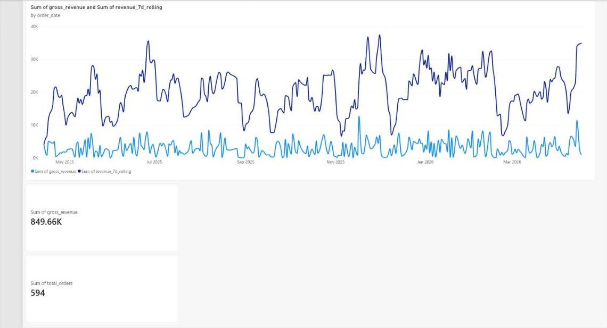
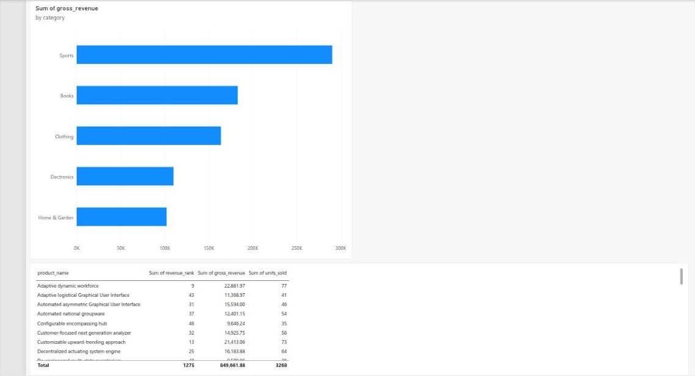
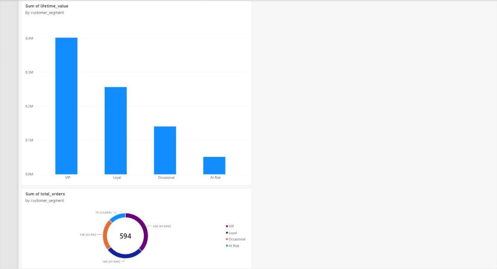

# Retail Sales Analytics Pipeline

An end-to-end data engineering project simulating a retail analytics platform.
Ingests multi-format source data, transforms it through a layered warehouse
architecture, orchestrates with Airflow, and serves a Tableau dashboard.

## Architecture

```
CSV / JSON / Excel  →  Staging  →  Models (star schema)  →  Marts  →  Tableau
                              Airflow orchestrates every layer
```

See [docs/architecture.md](docs/architecture.md) for the full diagram.

## Stack

| Layer         | Technology                        |
|---------------|-----------------------------------|
| Ingestion     | Python, pandas, SQLAlchemy        |
| Storage       | PostgreSQL 15 (Docker)            |
| Modeling      | SQL (star schema)                 |
| Orchestration | Apache Airflow 2.9 (Docker)       |
| Quality       | Custom Python checks              |
| Visualization | Tableau Cloud                     |

## Quickstart

### 1. Clone and install dependencies
```bash
git clone https://github.com/yourname/retail-pipeline.git
cd retail-pipeline
pip install -r requirements.txt
```

### 2. Configure environment
```bash
cp .env.example .env
# edit .env with your credentials
```

### 3. Start Postgres
```bash
docker compose up -d
```

### 4. Generate mock data and ingest
```bash
python ingestion/generate_data.py
python ingestion/load_to_staging.py
```

### 5. Build models and marts
```bash
python models/run_models.py
python marts/run_marts.py
```

### 6. Run quality checks
```bash
python quality/checks.py
```

### 7. Start Airflow
```bash
cd airflow
docker compose -f docker-compose.airflow.yml up -d
```
Access the Airflow UI at `http://localhost:8081` (admin / admin).
Trigger the `retail_pipeline` DAG to run the full pipeline end-to-end.

## Layer documentation

- [Ingestion](docs/ingestion.md) — how source files are read and staged
- [Models](docs/models.md) — star schema design and cleaning logic
- [Marts](docs/marts.md) — business aggregations and segmentation
- [Orchestration](docs/orchestration.md) — DAG structure and quality checks

## Dashboard

[View on Tableau Public →](https://public.tableau.com/your-dashboard-link)


### Power BI dashboard

A second dashboard was built in Power BI (Service) on top of the three marts (`mart_daily_revenue`, `mart_top_products`, `mart_customer_ltv`). The data is simulated, and only completed orders are counted (returned and cancelled orders are excluded by the pipeline). Totals reconcile with the SQL marts: 849,661.88 gross revenue across 594 completed orders.

| Page | Content |
|---|---|
| Revenue Trend | Daily gross revenue with 7-day rolling revenue, KPI cards for total revenue and orders |
| Top Products | Revenue by category and a ranked product table (revenue, units sold) |
| Customer Segments | Lifetime value and order share by customer segment (VIP, Loyal, Occasional, At Risk) |





## Project structure

```
retail_pipeline/
├── ingestion/       # Python scripts: generate and load source data
├── models/          # SQL: staging → dimensions + fact table
├── marts/           # SQL: fact → business-ready aggregations
├── quality/         # Data quality checks between pipeline layers
├── airflow/         # DAG definition and Airflow Docker setup
└── docs/            # Architecture diagram and layer documentation
```
